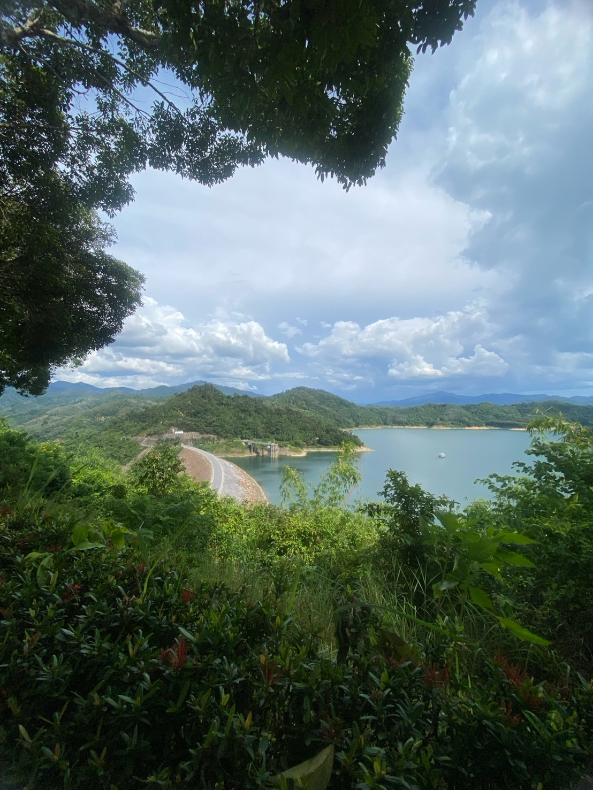
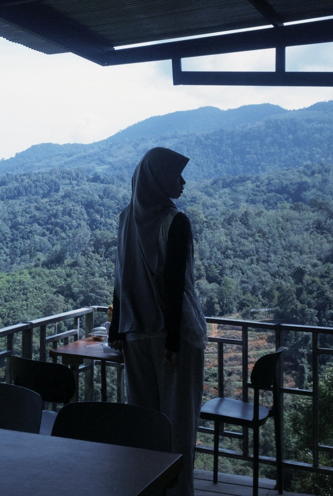
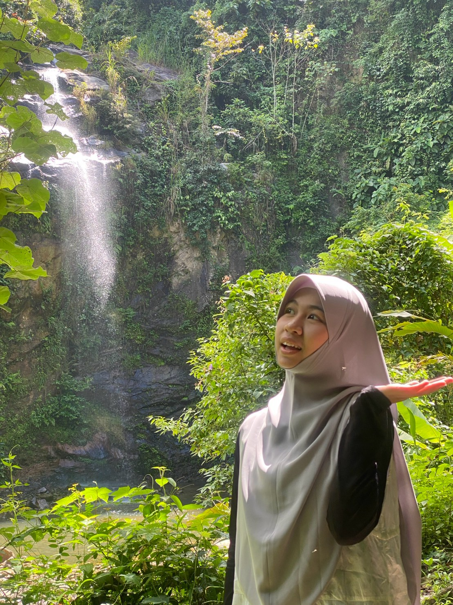
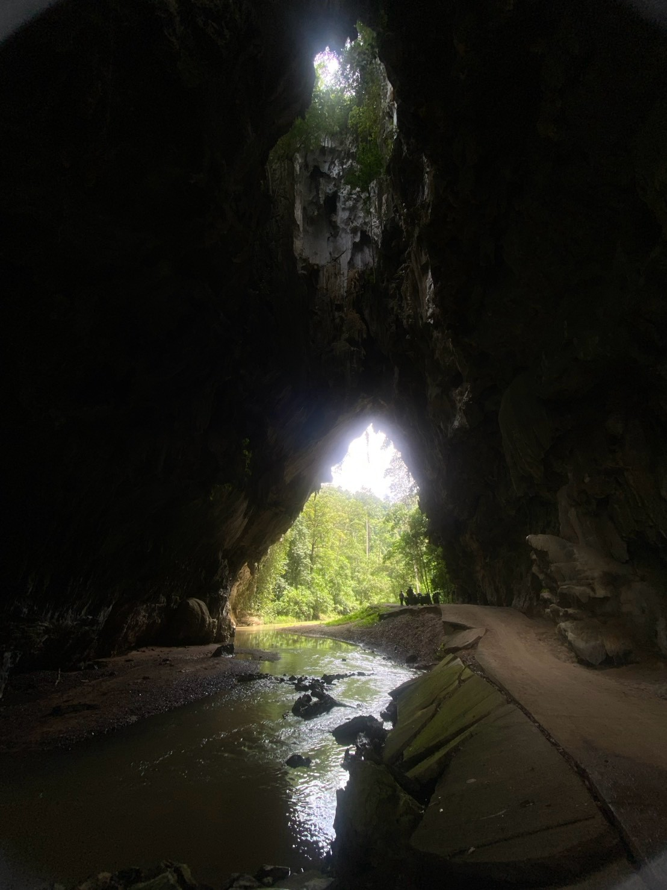

# 🌿 YALA DAY TRIP

> **Discover Yala, One Journey at a Time** — A curated, responsive, and accessible tourism editorial platform exploring a one-day motorcycle journey through the natural landscapes and cultural heritage of Yala Province, Southern Thailand.

[](https://abdullahxsahad-boop.github.io/day-trip/)
[](https://github.com/abdullahxsahad-boop/day-trip)
[](https://github.com/abdullahxsahad-boop/day-trip)

---

## 1. Project Title

**YALA DAY TRIP (เที่ยวยะลา 1 วัน — มนต์เสน่ห์แห่งขุนเขาและสายน้ำ)**  
*Creative Nature Journey — An Editorial Tourism Guide & Frontend Development Showcase.*

---

## 2. Live Website

- **Production URL:** [https://abdullahxsahad-boop.github.io/day-trip/](https://abdullahxsahad-boop.github.io/day-trip/)
- **Hosting Environment:** GitHub Pages (Static Web Hosting)
- **Primary Domain Canonical:** `https://abdullahxsahad-boop.github.io/day-trip/`

---

## 3. Project Overview

**YALA DAY TRIP** is a modern, single-page tourism web application designed to guide travelers through a realistic, culturally authentic one-day motorcycle itinerary in Yala Province. Conceived under the design philosophy **"Creative Nature Journey,"** the website combines the visual sophistication of a high-end travel magazine with the practical utility of an interactive tourism guide.

Every destination, distance, timeline sequence, and travel tip presented on the platform reflects real-world travel documentation across 5 major check-in destinations:
1. **MAT SALLEH Cafe** (Panoramic mountain viewpoint & morning breakfast)
2. **Namtok Sap Udom** (Multitiered forest waterfall in Bannang Sata)
3. **Batuka Stream (บาตูกา)** (Natural stream swimming, relaxing in the water, and peaceful riverside nature retreat)
4. **Tham Krachaeng** (Natural limestone cave with subterranean river passage)
5. **Bang Lang Dam Viewpoint** (Panoramic sunset vista overlooking the lake and reservoir)

---

## 4. Project Objectives

1. **Tourism Guidance & Cultural Showcase:** Provide accurate, verified, and practical travel information for tourists exploring Yala Province, promoting eco-friendly, respectful, and safe tourism.
2. **Frontend Architecture Showcase:** Demonstrate clean, maintainable, modular frontend development without reliance on heavyweight JavaScript frameworks (Zero React, Vue, or build-step dependencies).
3. **UI/UX & Editorial Design:** Establish a cohesive design system using CSS Custom Properties, Kanit + Inter typography, and an earthy color palette inspired by Southern Thailand's rainforests and mountains.
4. **Accessibility (a11y) & Usability:** Implement accessible navigation, keyboard focus management, ARIA landmark semantics, and reduced-motion support.
5. **Cross-Device Performance:** Ensure fluid, responsive behavior across mobile phones, tablets, laptops, and ultra-widescreen monitors.

---

## 5. Key Features

- **Interactive Itinerary Timeline:** Sequential 6-stop route tracker with synchronized visual card states and real-time encoded Google Maps search queries.
- **Accessible Photo Lightbox Modal:** Pure Vanilla JS modal dialog featuring touch swipe navigation, keyboard controls (`Escape`, `ArrowLeft`, `ArrowRight`), live caption and counter (`1 / 9`), and keyboard Tab focus trapping.
- **Native HTML5 Video Player:** Embedded local video player (`001.mp4`) showcasing authentic travel footage with custom poster image (`assets/images/bang-lang-dam.jpg`) and native controls.
- **WAI-ARIA FAQ Accordion:** Interactive FAQ section using `aria-expanded` and `aria-controls` for seamless screen reader compatibility.
- **Smart Sticky Navigation & Scrollspy:** Glassmorphism header that switches from transparent to frosted-glass on scroll, with active section highlighting powered by `IntersectionObserver`.
- **Mobile Slide-out Drawer:** Responsive 44×44px hamburger menu with smooth cubic-bezier transitions, backdrop blur overlay, and automatic background scroll locking.
- **Scroll Reveal Animations:** Subtle upward translation and opacity reveals powered by `IntersectionObserver` with instant fallback for users with `prefers-reduced-motion: reduce`.
- **Back-to-Top Interaction:** Floating action button that appears smoothly when scrolled past 500px.

---

## 6. Website Sections

The application is structured into 10 semantic sections:

| # | Section ID | Name | Semantic Element | Key Content |
|---|------------|------|------------------|-------------|
| 01 | `#hero` | Hero / Introduction | `<header>` | Full-viewport photography, editorial headline, dual CTAs, animated scroll indicator |
| 02 | `#about` | About Yala & Creator | `<section>` | Asymmetric editorial grid, landscape highlights, and Project Creator Credit card |
| 03 | `#overview` | Trip Overview | `<section class="section--dark">` | 4 quantitative metric cards (Duration, Stops, Budget, Vehicle) and travel specifications |
| 04 | `#route` | Travel Route Timeline | `<section>` | Interactive 6-stop sequential timeline with active states and direct Google Maps navigation |
| 05 | `#destinations` | Destinations Showcase | `<section>` | 5 comprehensive destination profiles with badges, operating hours, coordinates, and navigation links |
| 06 | `#gallery` | Photo Gallery | `<section class="section--cream">` | Uniform 3×3 grid of 9 authentic photographs with interactive hover overlay and full modal lightbox |
| 07 | `#video` | Travel Video | `<section>` | Responsive 16:9 native HTML5 video player documenting the actual motorcycle journey |
| 08 | `#tips` | Travel Tips & Prep | `<section class="section--sage">` | 6 practical advisory cards covering attire, equipment, fuel, weather, safety, and responsible tourism |
| 09 | `#faq` | Frequently Asked Questions | `<section>` | Accessible single-expand accordion answering common queries about safety, budgeting, and timing |
| 10 | `#footer` | Site Footer | `<footer>` | Semantic landmark with site map, creator credits, GitHub repository link, and copyright notice |

---

## 7. Technology Stack

- **Markup:** HTML5 (Semantic elements, Open Graph Protocol, Twitter Cards, SVG icons)
- **Styling:** CSS3 (CSS Grid, Flexbox, CSS `clamp()`, Custom Properties, Glassmorphism backdrop-filters, Hardware-accelerated CSS animations)
- **Scripting:** Vanilla JavaScript (ES6+, IIFE modularization, `IntersectionObserver`, Touch Gestures, Keyboard Event Listeners)
- **Typography:** Google Fonts — [Kanit](https://fonts.google.com/specimen/Kanit) (Thai headings & body) and [Inter](https://fonts.google.com/specimen/Inter) (English accents & metrics)
- **Hosting:** GitHub Pages (Static site deployment)
- **Dependencies:** **Zero external runtime libraries** (No jQuery, React, Bootstrap, or Tailwind)

---

## 8. Project Structure

```
day-trip/
├── index.html                   # Master production HTML5 document (all 10 sections)
├── index.backup.html            # Original prototype backup preserved intact
├── robots.txt                   # Search crawler indexing rules
├── sitemap.xml                  # XML sitemap for search engine indexing
├── 001.mp4                      # Native local travel footage (5.40 MB)
│
├── assets/
│   └── images/                  # High-resolution authentic trip photography
│       ├── author.jpg           # Project Creator portrait (Abdullah Sahad)
│       ├── bang-lang-dam.jpg    # Bang Lang Dam reservoir panoramic overlook
│       ├── cafe-view.jpg        # MAT SALLEH Cafe terrace overlook
│       ├── cafe-dining.jpg      # MAT SALLEH Cafe dining area
│       ├── cafe-selfie.jpg      # Cafe signage photograph
│       ├── cafe-selfie-2.jpg    # Cafe viewpoint photograph
│       ├── waterfall-back.jpg   # Namtok Sap Udom cascade rear angle
│       ├── waterfall-portrait.jpg# Namtok Sap Udom stream cascade
│       ├── cave-stream.jpg      # Tham Krachaeng subterranean stream passage
│       ├── cave-interior.jpg    # Tham Krachaeng stalactite cavern
│       └── favicon.png          # Browser favicon icon
│
├── css/
│   ├── style.css                # Design tokens, typography, and component styling (28 KB)
│   ├── responsive.css           # 12-breakpoint responsive layout system (9 KB)
│   └── animation.css            # IntersectionObserver keyframes and motion controls (3 KB)
│
├── js/
│   ├── main.js                  # Scroll reveals, back-to-top handler, native lazyload (3.3 KB)
│   ├── navigation.js            # Sticky nav, mobile drawer, scrollspy observer (3.2 KB)
│   ├── gallery.js               # Lightbox dialog, touch swipe gestures, focus trap (4.7 KB)
│   ├── route.js                 # Interactive timeline selection & map query handling (1.7 KB)
│   └── faq.js                   # Accessible WAI-ARIA accordion toggle (1.5 KB)
│
├── CODE_REVIEW_REPORT.md        # Comprehensive 11-point QA and code review audit
├── RESPONSIVE_TEST_REPORT.md    # 12-viewport cross-device test verification report
├── PROJECT_HANDOFF.md           # Continuous architecture log & maintenance documentation
└── README.md                    # Professional GitHub Portfolio README (this document)
```

---

## 9. Responsive Design

The responsive architecture utilizes fluid design principles, avoiding brittle fixed-pixel widths. The layout dynamically adapts across **12 target viewport widths**:

| Category | Viewport Width | Device Archetype | Layout Adaptations |
|:---------|:---------------|:-----------------|:-------------------|
| **Ultra-Widescreen** | `1920px+` | 4K Monitors & Ultrawides | Centered `max-width: 1440px`, hero min-height 800px, 3×3 gallery |
| **Large Desktop** | `1440px` | 27" iMac, QHD Displays | `max-width: 1320px`, optimal reading column width (65–75 chars) |
| **Standard Laptop** | `1280px` | 13"–14" MacBooks / PC Laptops | Fluid `var(--space-lg)` padding, 4-col overview stats |
| **Tablet Landscape** | `1024px` | iPad Pro 12.9", Surface Pro | Overview stats reflow to 2×2 grid, footer 2-col |
| **Tablet Portrait** | `820px` | iPad Air, iPad Pro 11" | 2-col gallery, 16:9 destination media card ratio |
| **Small Tablet / Large Phablet** | `768px` | iPad 9th/10th Gen | **Mobile slide-out drawer navigation activates**, timeline left-aligns |
| **Foldables / Phablets** | `600px` | Galaxy Z Fold (unfolded) | Single-col content flow, compact stat card padding |
| **Large Smartphone** | `430px` | iPhone 14/15/16 Pro Max | Gallery reflows to 1-col immersive photo stream, full-width CTAs |
| **Standard Smartphone** | `390px` | iPhone 12/13/14/15/16 | `clamp()` typography scaling, author avatar 88px, timeline marker 30px |
| **Compact Smartphone** | `375px` | iPhone SE (2nd/3rd gen) | Section titles 1.5rem, stat card values 1.35rem, zero overflow |
| **Budget Android** | `360px` | Samsung Galaxy A-series | 1-col overview stats, full 100vw mobile drawer |
| **Ultra-Small Mobile** | `320px` | iPhone SE (1st gen) | Root font 0.9rem, 8px container padding, author avatar 72px |

---

## 10. Accessibility (a11y)

The project has been reviewed against **WCAG 2.2 AA** guidelines with verified technical evidence:

- **Semantic HTML & Landmark Hierarchy:** Native semantic elements (`<header>`, `<nav>`, `<main>`, `<section>`, `<article>`, `<footer>`) with strictly non-skipping heading hierarchy (`h1` → `h2` → `h3`).
- **Interactive Target Sizing (WCAG 2.2 SC 2.5.8):** All clickable controls (mobile hamburger toggle, navigation items, CTA buttons, lightbox controls, accordion headers, social links) meet or exceed the **44 × 44 CSS pixels** minimum touch target standard.
- **Keyboard Navigation & Focus Management:**
  - Skip-to-content link (`<a href="#main-content" class="skip-link">`) allows keyboard users to bypass navigation.
  - Lightbox dialog implements a bidirectional **Tab focus trap** ensuring keyboard focus does not leak to the background page.
  - Visible focus indicators (`:focus-visible`) styled with high-contrast outlines for keyboard users, while suppressed for mouse users via `body.using-mouse`.
- **WAI-ARIA Attributes:**
  - Hamburger toggle manages `aria-expanded` and `aria-controls`.
  - Accordion headers manage `aria-expanded="true|false"` and `aria-controls="faq-answer-*"`.
  - Lightbox caption and counter elements use `aria-live="polite"` for dynamic screen reader announcements.
- **Motion Accessibility:**
  - `@media (prefers-reduced-motion: reduce)` in `css/animation.css` disables scroll reveals, transforms, and continuous pulse animations for users with vestibular sensitivities.
- **Image Alternative Text:** All meaningful photographs feature descriptive Thai `alt` text; decorative icons are hidden from assistive technology with `aria-hidden="true"`.

---

## 11. Performance Considerations

- **Zero Dependency Overhead:** Total JavaScript payload is under 15 KB unminified across 5 modular scripts.
- **Native Lazy Loading:** All below-the-fold images leverage `loading="lazy"` with an `IntersectionObserver` fallback for legacy browsers.
- **Non-blocking Lightbox Placeholder:** The modal lightbox image utilizes a transparent inline SVG data URI (`data:image/svg+xml,...`) to eliminate empty `src` GET requests on page load.
- **Hardware Acceleration:** Animations and transitions utilize `transform` and `opacity` properties to ensure 60fps GPU-composited rendering.
- **Resource Preconnection:** Google Fonts servers are preconnected via `<link rel="preconnect">` to minimize DNS resolution latency.
- **Video Optimization:** The travel video (`001.mp4`) uses `preload="metadata"` and a static poster frame to prevent unnecessary background video data consumption on initial page render.

---

## 12. Getting Started

### View Online (Recommended)
Visit the live deployment at [https://abdullahxsahad-boop.github.io/day-trip/](https://abdullahxsahad-boop.github.io/day-trip/)

### Run Locally

1. **Clone the repository:**
   ```bash
   git clone https://github.com/abdullahxsahad-boop/day-trip.git
   cd day-trip
   ```

2. **Serve with any static HTTP server:**
   Using Node.js (`npx serve`):
   ```bash
   npx serve .
   ```
   Or using Python 3:
   ```bash
   python -m http.server 8000
   ```
   Or simply double-click and open `index.html` directly in any modern web browser.

*No build steps, compilers, or package installations are required.*

---

## 13. Screenshots

The website exclusively uses authentic, high-resolution photographs taken on-site during the actual motorcycle road trip across Yala Province:

| Destination Overview | Cultural & Natural Landscape |
|:--------------------:|:----------------------------:|
|  |  |
| *เขื่อนบางลาง — ทิวทัศน์ทะเลสาบและอ่างเก็บน้ำ* | *MAT SALLEH Cafe — จุดชมวิวม่านหมอกยามเช้า* |
|  |  |
| *น้ำตกทรัพย์อุดม — สายน้ำธรรมชาติกลางป่า* | *ถ้ำกระแชง — ธารน้ำไหลลอดถ้ำหินปูนธรรมชาติ* |

---

## 14. Skills Demonstrated

This project serves as a showcase of core frontend engineering and design competencies for **Software Engineer / Frontend Developer Internship Applications**:

1. **Semantic Web Architecture:** Writing clean, accessible, and standards-compliant HTML5 without framework abstractions.
2. **Modern CSS Engineering:** Building a scalable design token architecture using CSS custom properties, responsive grid systems, fluid clamp scaling, and modular stylesheets.
3. **Vanilla JavaScript Mastery:** DOM manipulation, custom event handling, touch gesture recognition, modal dialog focus traps, and efficient browser APIs (`IntersectionObserver`, `scrollIntoView`).
4. **UI/UX & Visual Direction:** Creating an editorial visual identity ("Creative Nature Journey") that balances immersive media with clear visual hierarchy and typography.
5. **Quality Assurance & Code Review:** Conducting systematic static code audits, heading validation, touch target measurement, and cross-browser verification.
6. **Web Security & Privacy:** Mitigating reverse tabnabbing vulnerabilities (`rel="noopener noreferrer"`) and safeguarding author privacy.

---

## 15. Future Improvements

- [ ] **Service Worker & PWA:** Add offline caching for itinerary details, emergency contacts, and maps when traveling through areas with limited cell coverage.
- [ ] **Bilingual Toggle (TH / EN):** Implement an accessible language switch for international tourists visiting Southern Thailand.
- [ ] **Live Weather Integration:** Connect a lightweight, client-side API to fetch real-time weather and rainfall alerts for Bannang Sata and Than To districts.
- [ ] **Interactive GPX Route Map:** Provide downloadable GPX coordinates for motorcycle GPS navigation units.

---

## 16. Author Information

**Abdullah Sahad**  
*Web Developer & Project Designer*

- **GitHub:** [@abdullahxsahad-boop](https://github.com/abdullahxsahad-boop)
- **Project Repository:** [day-trip](https://github.com/abdullahxsahad-boop/day-trip)
- **Live Demo:** [https://abdullahxsahad-boop.github.io/day-trip/](https://abdullahxsahad-boop.github.io/day-trip/)

---

## 17. Copyright & License

© 2026 Abdullah Sahad — **YALA DAY TRIP**. All original photographs, videos, and custom website source code are protected. Distributed for portfolio presentation and educational demonstration.
